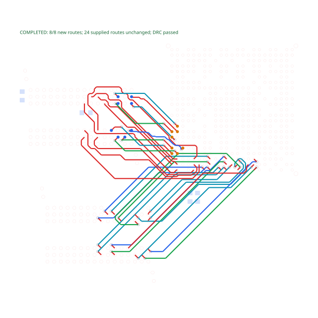

# A64 fourth DDR data byte

The real OLIMEX A64-OLinuXino revision H TSX circuit completes its first 24 DQ routes, then fails to route the last eight. The native 607 pad primitives, six-layer stack, signal layers, trace widths, clearances and no-via-in-pad rule are unchanged.

The captured input is from published tscircuit `0.0.3082`, core `0.0.2268`, autorouter `0.0.1038` and bundled bus solver `0.0.42`. Removing only the 24 supplied traces lets the same eight connections route cleanly. The failing first signal has no escape among the sampled BGA-grid sites.

The regression intentionally fails on the repro branch. Its SVG shows only the previously completed 24 routes, with a red failure caption. The fix must replace this same SVG after all eight new routes and the 24 immutable supplied routes pass connectivity and DRC.



```sh
bun test tests/a64-preloaded-byte3.test.ts --timeout 120000
```

The original [TSX board](../preloaded-ddr/circuits/a64.tsx), native component implementation and compressed placement source are reused. To recapture all four data bytes through published core:

```sh
cd repros/a64-byte3
bun install
bun run.tsx
```

The fourth-byte input is `results/phase-7-input.srj.json`. The runner saves each core phase and exports a final board SVG only when all 32 selected DQ connections complete. These are DQ-only routes; clocks, strobes, address/control signals and DDR timing closure are outside this repro's scope.

[PCB source, license, package versions and input hash](../../tests/fixtures/a64-preloaded-byte3/provenance.json). Fixed endpoint definitions are captured from the first three routing phases.

Benchmark effect: this repro changes no production solver or AM3352 benchmark behavior. The required fresh eleven-case comparison is reported in the stacked fix.
