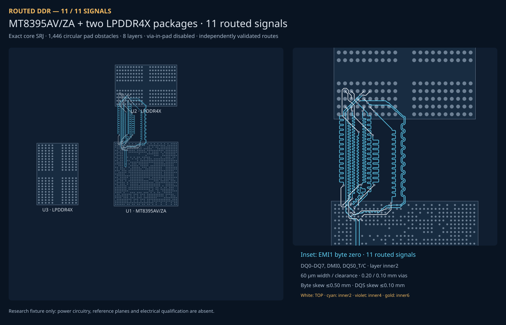

# MT8395 LPDDR4X: exact core input reproduction



[Visual snapshot](board.snap.svg) · [full-board SRJ](../../tests/fixtures/mt8395-core/full.srj.json) · [byte-zero SRJ](../../tests/fixtures/mt8395-core/byte0.srj.json) · [DQS-pair SRJ](../../tests/fixtures/mt8395-core/pair.srj.json) · [measured baseline](baseline.json)

The **byte-zero capture now routes all 11 signals**, including the coupled DQS pair, with its original timing and manufacturing constraints. [Completed byte snapshot](byte0.snap.svg), [validated copper](routed/byte0.srj.json.gz), and [solve report](routed/byte0-report.json) are retained for review. The snapshot is exported only after solver success and independent validation.

The full 138-signal case is still under development. `board.snap.svg` remains its clearly labeled input-only diagnostic: dashed lines are unrouted requests. It is not a completed full-board result. No failed or intermediate copper is published.
## Replay the exact request

From the repository root, install its dependencies with `bun install`, then:

```sh
# No core installation is needed for these solver-only replays.
bun repros/mt8395-lpddr4x/run.ts pair --timeout-ms 30000
bun repros/mt8395-lpddr4x/run.ts byte0 --timeout-ms 60000
bun repros/mt8395-lpddr4x/run.ts full --timeout-ms 1800000
```

Each command imports **this checkout's** `BusLanesPipelineSolver` from `lib/index.ts`, passes an immutable, hash-checked capture directly to its constructor, and performs a fresh matched solve. No top-level `allowedLayers` is added; no connections, metadata, pads, bus limits, pair constraints, or via permissions are changed. The only solver option is an elapsed-time budget. `--solver /absolute/path/to/another-checkout/lib/index.ts` and `--label before` support comparisons without changing the input.

Failure exits nonzero and saves `results/<label-or-case>/report.json`, including the input hash, stage, failure code, iterations, elapsed time and solver statistics. `output.srj.json` is written only when the solver reports success; `accepted.srj.json` additionally requires full connectivity, copper DRC, no illegal via-in-pad holes, bus/pair matching and exterior coupling. A solver success flag alone is not acceptance. Reports and output routes are ignored by Git; the compact baseline is tracked separately.

## Source board and native core capture

The source board uses the actual MT8395AV/ZA 1,046-ball map and two Micron MT53E1G32D2FW-046 WT:B 200-ball LPDDR4X maps. The three separate source scopes generate these requests:

| Scope | Signals | Buses | Differential pairs | Pads retained |
| --- | ---: | ---: | ---: | ---: |
| `full` | 138 | 18 | 12 | 1,446 |
| `byte0` | 11 | 1 | 1 | 1,446 |
| `pair` | 2 | 1 | 1 | 1,446 |

The full request includes four 16-bit channels and two package resets. Byte zero contains DQ0–7, DMI0 and DQS0_T/C of EMI1. All unselected pad obstacles remain in the reduced source scopes. These are **independently captured native core requests**, not edits or filtered copies of the full SRJ.

To reproduce the capture with the pinned published runtime:

```sh
cd repros/mt8395-lpddr4x/source
bun install --frozen-lockfile --ignore-scripts
bun capture.tsx full
bun capture.tsx byte0
bun capture.tsx pair
```

`capture.tsx` listens to `autorouting:start` with the ordinary `<autoroutingphase autorouter="bus_lanes" />`, copies `event.simpleRouteJson`, and deliberately interrupts before core constructs the router. It does not install an `algorithmFn` or alter the input. The expected "input captured; intentionally stopped" message is not a routing failure. Captures are written to `../results/capture-<scope>/`; compare them with `tests/fixtures/mt8395-core/`. Every fresh native capture matched the prior experimental capture field-for-field and by canonical JSON SHA-256.

Capture runtime: `tscircuit@0.0.3057`, `@tscircuit/core@0.0.2252`, Bun 1.4.4. The nested lockfile pins the runtime independently from the repository solver. The explicit `capacity-autorouter@0.0.1030` peer pin prevents an older transitively hoisted package from failing core's module imports; capacity routing is never invoked. The published bus-lanes dependency is also never invoked during capture. Solver replays always use the repo implementation.

## Input audit: no core fix required

The built-in capture and core implementation agree on:

- Every endpoint coincides with its owning circular SMT pad, with the connection and port IDs retained in obstacle ownership.
- All three packages and all 1,446 obstacles remain present; positions are board-world millimeters, +X right and +Y up.
- Byte buses retain their per-bus `allowedLayers`; pair skew and gap are retained. A global allowed-layer field is optional in the solver's public input contract.
- Trace width / clearance are 0.06 mm; via pad / hole diameters are 0.20 / 0.10 mm; `allowViaInPad` and `allowBlindAndBuriedVias` remain false.

Core maps `pcbAllowedLayers` to `bus.allowedLayers` in `getBusesForSimpleRouteJson`, forwards the board's via permission in `getSimpleRouteJsonFromCircuitJson`, and passes the input unchanged in `BusLanesAutorouter`. Source inspected at core commit `f6fbff6ee8904f84b058f5f8cfeed88a0aec062f`; fresh captures use the pinned published core above.

The earlier redundant-global-layer workaround is intentionally absent here. Solver strategy selection distinguishes per-bus restrictions from an explicit global inner carrier; that is a solver-side behavior, not evidence that core dropped a required field. No core PR is needed for this repro.

## Routing strategy

The pipeline recognizes disjoint native buses pinned to individual inner layers, including restrictions supplied only on each bus. It reserves local escapes before placing all coupled pairs, then negotiates ordinary signals together on each shared carrier. Each bus keeps its own timing window; command/address buses without a differential anchor derive starting targets from fresh native paths. Search windows are bounded around the participating packages without changing board geometry or removing obstacles.

The final acceptance gate checks the original full-board input, including whole-signal lengths, differential coupling, self-clearance, through-via clearance, and endpoint connectivity. Existing supplied-fanout and native strategies retain their dispatch precedence.

## Observed baseline and acceptance

At solver commit `005bee4ae0af17cea30108e4f57d58cd4b2dc430`, the exact two-signal input fails with `Insufficient tuning clearance for source_trace_0`. The byte and full-board requests exceed their 60-second budgets; see `baseline.json` for fresh source-checkout measurements. A bounded search failure is not proof that the geometry is impossible.

The prior connectivity-only experiment is **not** replayed here because it changes the solver goal and adds a global layer. It also emitted same-net via holes inside SMT pads despite via-in-pad being forbidden. `validate.ts` includes an ownership-independent hole-to-pad check so a future fix cannot publish that invalid geometry merely because its electrical connectivity or different-net clearance checks pass.

```sh
bun test tests/mt8395-core-input.test.ts
bun repros/mt8395-lpddr4x/snapshot.ts repros/mt8395-lpddr4x/results/byte0 byte0
```

The tests verify input ownership and constraints, fresh pair/byte solves, deterministic accepted-copper rendering, and rejection of missing routes and same-net via-in-pad output. Changing the solver requires fresh replays; revalidating retained output is not a solve.

## Hardware scope and provenance

This is an eight-layer, 60 × 60 mm routing research fixture. Experimental pad/trace/via geometry and 0.50 mm byte / 0.10 mm pair skew / 0.08 mm pair gap are software-test constraints, **not manufacturer timing sign-off or fabrication approval**. Power routing, reference planes, decoupling, calibration/termination, boot circuitry, package delay, via delay and signal-integrity qualification are absent. It is not a functional or manufacturing-ready computer.

Factual package geometry and ball assignments come from:

- [MediaTek MT8395 datasheet v1.8](https://mediatek-marketing.files.svdcdn.com/production/documents/MTK_MT8395_Application-Processor-Datasheet_v1.8.pdf?dm=1724252510): quadrant maps pp.419–427, pin characteristics and package drawing p.487. All 142 EMI assignments were independently checked against the pin-characteristics table. AN37 is populated as DVSS from the power table p.462 despite being blank in the quadrant map.
- [Micron LPDDR4X/LPDDR4 specification, Rev. G](https://e2e.ti.com/cfs-file/__key/communityserver-discussions-components-files/791/z42m_5F00_embedded_5F00_lpddr4x_5F00_lpddr4_2D00_3077590.pdf): dual-rank ball map p.24 and FW package drawing p.30.

The PDFs are not redistributed. CPU pad diameter and fabrication rules are explicit experimental assumptions. No pin swapping or existing route replay is used.

Benchmark effect: this stacked change adds routing for native per-bus carrier restrictions and strengthens native repair feedback. AM3352 fixtures and acceptance rules are unchanged. The required fresh, paired 11-sample Blacksmith benchmark comparison must be reported and pass before merge; retained-output validation is not a fresh solve.
