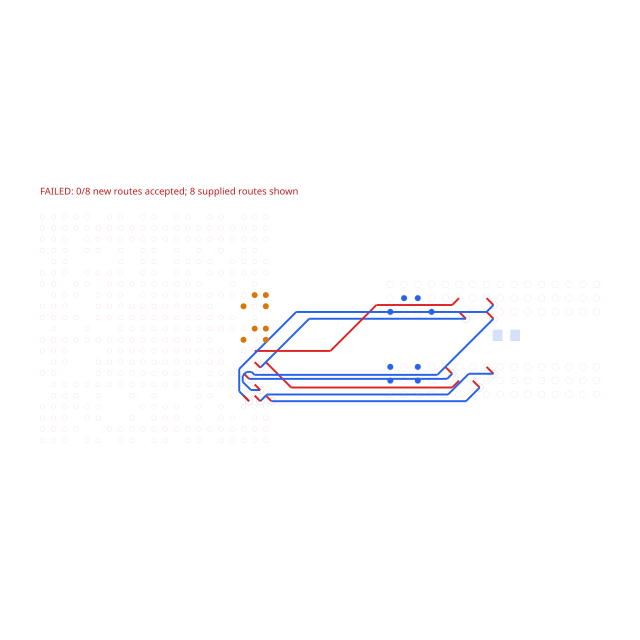
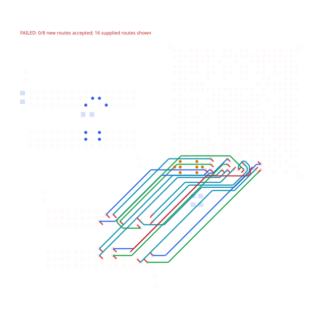

# H3 and A64 routing after earlier DDR bytes

These inputs come from real boards reconstructed in TSX and rendered through published `tscircuit 0.0.3077`, core `0.0.2267` and autorouter `0.0.1038`. Native component pads, signal layers, widths, clearances and existing byte copper are preserved. No timing constraints are invented.

| Captured phase | Requested routes | Supplied earlier routes | Pads |
| --- | ---: | ---: | ---: |
| H3 byte1 | 8 | 8 | 445 |
| A64 byte2 | 8 | 16 | 607 |

On base `54dfacb`, both full TSX runs time out after 120 seconds at these phases. Removing only the supplied `traces` field lets each byte complete cleanly. The repro tests use a deterministic 60,000-step budget to expose the same failure without waiting for the full timeout.

The nearby via sites are occupied by earlier copper. Initial escape allocation falls back to the pad layer, and the interconnect search repeatedly negotiates around those fixed generated approaches. The supplied traces must remain immutable; new approaches and carrier layers may change.

The tests are intentionally red on the repro branch. Their SVGs show the supplied completed copper and clearly label that none of the eight new routes were accepted. The stacked fix replaces the same SVG files only after validating every requested route, supplied-route preservation, DRC and native wire geometry.





Run from the repository root:

```sh
bun test tests/h3-preloaded-byte.test.ts tests/a64-preloaded-byte.test.ts --timeout 120000
```

The original full-board TSX and native placements are in `circuits/`. To recapture the core inputs, install this directory's pinned package and run `bun run-board.tsx h3 results/h3` or `bun run-board.tsx a64 results/a64`, with an external 120-second process limit. Each routing-start event writes its SRJ before the solve. H3's second-byte input is `phase-3-input.srj.json`; A64's third-byte input is `phase-5-input.srj.json`.

Source PCB links, commits, original hashes and published package versions are retained in `tests/fixtures/{h3,a64}-preloaded-byte/provenance.json`. H3 is from `hvwyl/allwinner-h3-ddr3-16x1-kicad`; A64 is from OLIMEX A64-OLinuXino revision H.

The repro changes no production solver or AM3352 benchmark behavior. It does not claim completion of the full 53/75-connection DDR sections or DDR timing closure.
